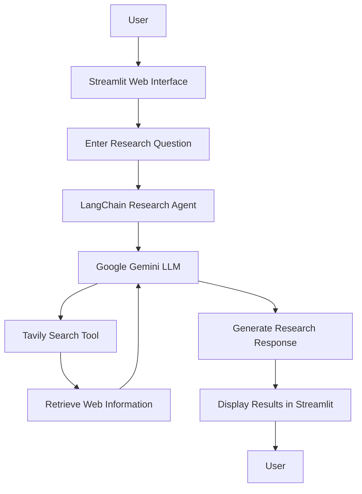

# 🤖 Yasir Research Agent — AI-Powered Real-Time Research Assistant

An intelligent AI research assistant built with **Python, Streamlit, LangChain, Google Gemini, and Tavily Search**. The application allows users to ask research questions through a simple web interface and receive AI-generated responses based on real-time web search results.

## 📌 Project Overview

The Yasir Research Agent is an Agentic AI application designed to simplify online research and information discovery.

The application integrates a Large Language Model (LLM) with a web search tool, enabling the AI agent to retrieve relevant information and generate meaningful responses to user queries.

With Streamlit, users can interact with the research agent through a clean and user-friendly interface without needing to execute queries directly from the terminal.

## ✨ Key Features

- 🤖 **AI-Powered Research:** Uses Google Gemini to understand user questions and generate responses.
- 🔎 **Real-Time Web Search:** Uses Tavily Search to retrieve relevant and current web information.
- 🌐 **Interactive Web Interface:** Built with Streamlit for easy user interaction.
- ⚡ **Agentic AI Workflow:** Uses LangChain to connect the AI model with external search tools.
- 💬 **Dynamic Query Input:** Users can enter custom research questions.
- 🔄 **Loading Feedback:** Displays a spinner while the agent is searching and generating a response.
- 📝 **Research Results Display:** Presents the generated answer directly in the application.
- 🛡️ **Input Validation:** Warns users when they attempt to search without entering a question.

## 🛠️ Technologies Used

| Technology | Purpose |
|---|---|
| Python | Core application programming |
| Streamlit | Interactive web application interface |
| LangChain | AI agent orchestration |
| Google Gemini | AI reasoning and response generation |
| Tavily Search | Real-time web research |
| `langchain-google-genai` | Gemini model integration |
| `langchain-tavily` | Tavily search integration |
| `python-dotenv` | Secure environment variable management |
| uv | Python dependency and environment management |

## 🏗️ Application Architecture



## 📂 Project Structure

```text
Aagentic_AI/
│
├── main.py                 # AI research agent implementation
├── app.py                  # Streamlit web application
├── test_gemini.py          # Gemini API testing
├── list_models.py          # Available Gemini model listing
├── .env                    # API credentials
├── .gitignore              # Git ignored files
├── pyproject.toml           # Project dependencies
├── uv.lock                 # Dependency lock file
└── README.md               # Project documentation
```

## ⚙️ Installation and Setup

### 1. Clone the Repository

```bash
git clone https://github.com/YOUR_USERNAME/ai-research-agent.git
```

### 2. Navigate to the Project Folder

```bash
cd ai-research-agent
```

### 3. Install Dependencies

```bash
uv sync
```

### 4. Configure API Keys

Create a `.env` file in the project root directory:

```env
GOOGLE_API_KEY=your_google_gemini_api_key
TAVILY_API_KEY=your_tavily_api_key
```

Get your API keys from:

- Google AI Studio: https://aistudio.google.com/
- Tavily: https://tavily.com/

**Security Note:** Never commit your `.env` file or expose your API keys on GitHub.

### 5. Run the Streamlit Application

```bash
uv run streamlit run app.py
```

The application will launch in your browser, usually at:

```text
http://localhost:8501
```

## 💡 How to Use the Application

1. Launch the Streamlit application.
2. Open the Research Agent interface.
3. Enter a research question in the input field.
4. Click the **Run Search** button.
5. Wait while the agent searches for relevant information.
6. Read the generated research response.

## 🧪 Example Research Queries

```text
What is the latest news about the Tesla Roadster?
```

```text
What are the latest developments in Artificial Intelligence?
```

```text
What are the current trends in cloud computing?
```

```text
What are the recent innovations in fintech?
```

## 🎯 Learning Outcomes

This project demonstrates practical experience in:

- Building an Agentic AI application.
- Integrating Large Language Models into Python applications.
- Creating AI agents with LangChain.
- Connecting AI agents to external search tools.
- Developing interactive AI applications using Streamlit.
- Handling API responses and model errors.
- Managing API keys using environment variables.
- Building a complete AI application from backend logic to frontend interface.

## 🔮 Future Enhancements

Potential future improvements include:

- Conversation memory for multi-turn research.
- Displaying source URLs and citations alongside responses.
- Downloading research reports as PDF documents.
- Chat history management.
- Multi-agent research workflows.
- Advanced research modes.
- Deployment to Streamlit Community Cloud.

## 👨‍💻 Developer

**Yasir Abdul-Rahaman**

Computer Science Graduate | AI & Machine Learning Enthusiast | Cloud Computing & Data Analytics

This project represents my continued learning and practical exploration of Agentic AI, intelligent automation, and Large Language Model applications.

## ⭐ Acknowledgment

This project was developed as part of my hands-on journey into AI application development. It helped me understand how Large Language Models can interact with external tools to perform research tasks and deliver useful information through an interactive web interface.

If you find this project useful or interesting, please consider giving the repository a ⭐.

---

**Building intelligent solutions with AI, one project at a time.** 🚀